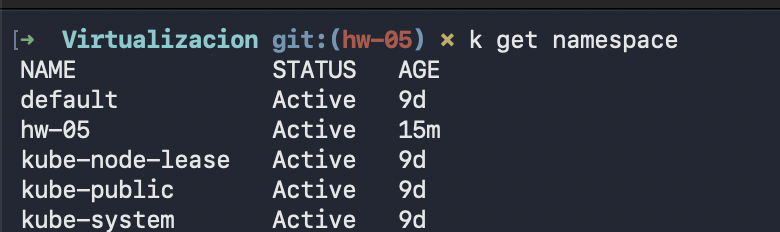
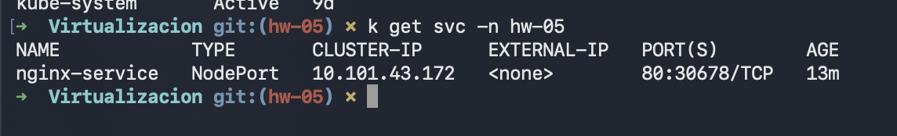
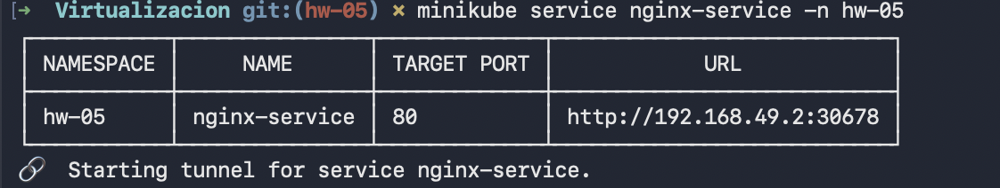
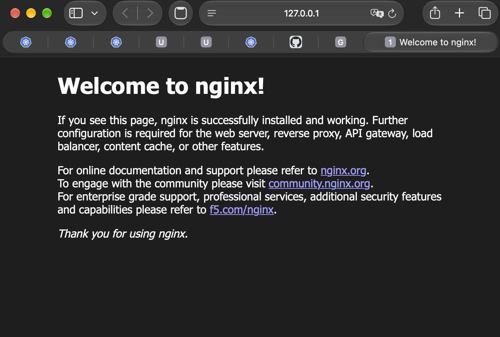

# HW-05 - Kubernetes Nginx Service

In this activity, I created a Kubernetes environment to deploy Nginx and access it from the local browser.

## Namespace creation

First, I created a namespace called `hw-05`.

## Access to the Nginx Service

After creating the Service, Minikube was used to access it from the local computer.

Minikube created a local URL connected to the Nginx Service.

## Nginx running

After opening the local URL in the browser, the default Nginx page was displayed correctly.

This confirmed that the Deployment and the Service were working correctly.

