# Personal Project 01 - Monitoring Stack

This project implements a monitoring stack in the existing Minikube cluster using:

- Prometheus
- Loki
- Promtail
- Grafana
- Traefik
- MetalLB

All monitoring components were installed in:

```text
monitoring-mdma
```

The monitored applications are located in:

```text
parcial-mdma
```

---

## 1. Prometheus Installation

Prometheus was installed using Helm inside the `monitoring-mdma` namespace.

The installation includes:

- Prometheus Server
- kube-state-metrics
- node-exporter

```bash
helm install prometheus prometheus-community/prometheus \
  --namespace monitoring-mdma \
  -f monitoring/prometheus/values.yaml
```

The Prometheus components are running correctly.

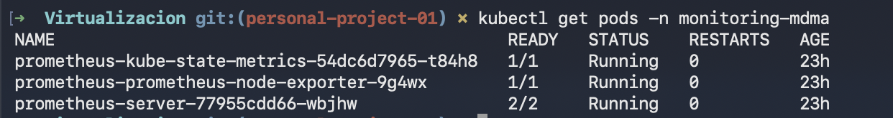

---

## 2. Prometheus Targets

Prometheus was configured to collect Kubernetes cluster metrics.

The Targets section confirms that the Kubernetes targets are in `UP` state.

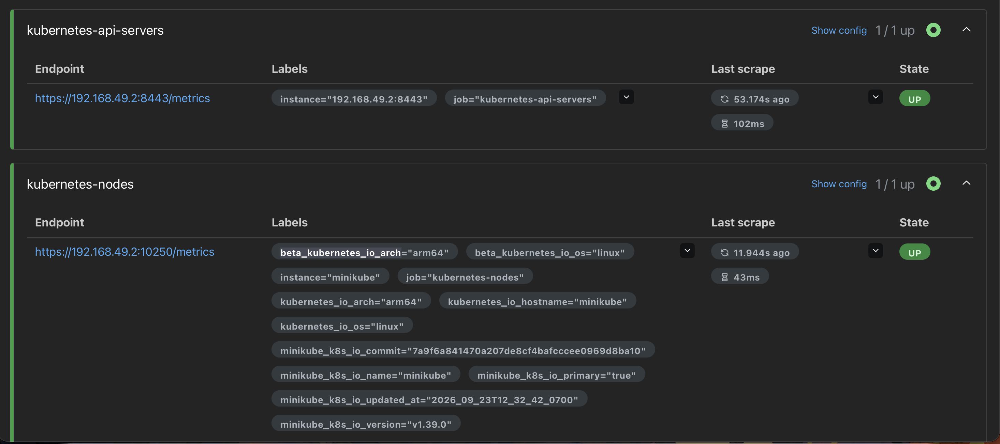

---

## 3. Prometheus Cluster Metrics

Prometheus successfully collects metrics from Kubernetes services and nodes.

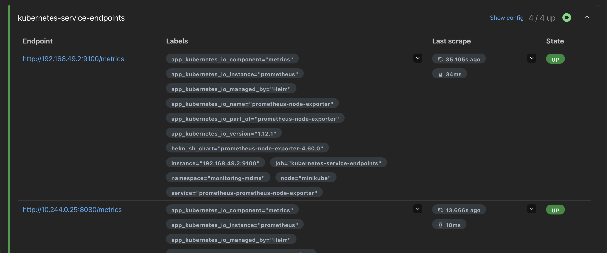

The cAdvisor target is also available and provides container metrics.


---

## 4. Loki Installation

Loki was installed using Helm in `SingleBinary` mode.

```bash
helm install loki grafana/loki \
  --namespace monitoring-mdma \
  -f monitoring/loki/values.yaml
```

A PersistentVolumeClaim was configured for Loki storage.

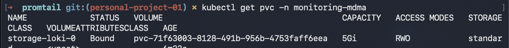

---

## 5. Promtail Installation

Promtail was installed as a DaemonSet.

```bash
helm install promtail grafana/promtail \
  --namespace monitoring-mdma \
  -f monitoring/promtail/values.yaml
```

Promtail is running correctly.

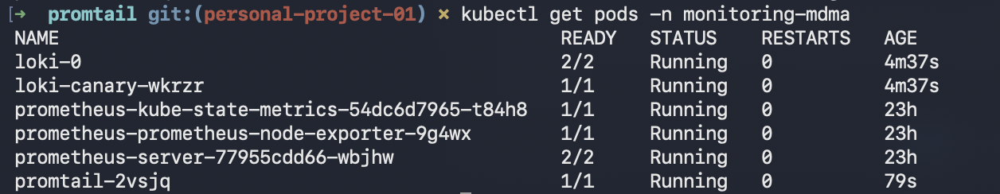

Promtail was deployed as a DaemonSet to collect container logs from the Minikube node.

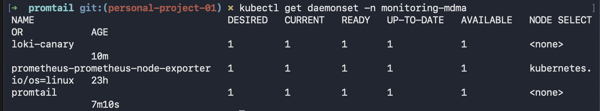

---

## 6. Application Logs in Loki

Promtail was configured to collect logs from the namespace:

```text
parcial-mdma
```

This includes the four applications:

- app1
- app2
- app3
- app4

The logs were verified directly in Loki.

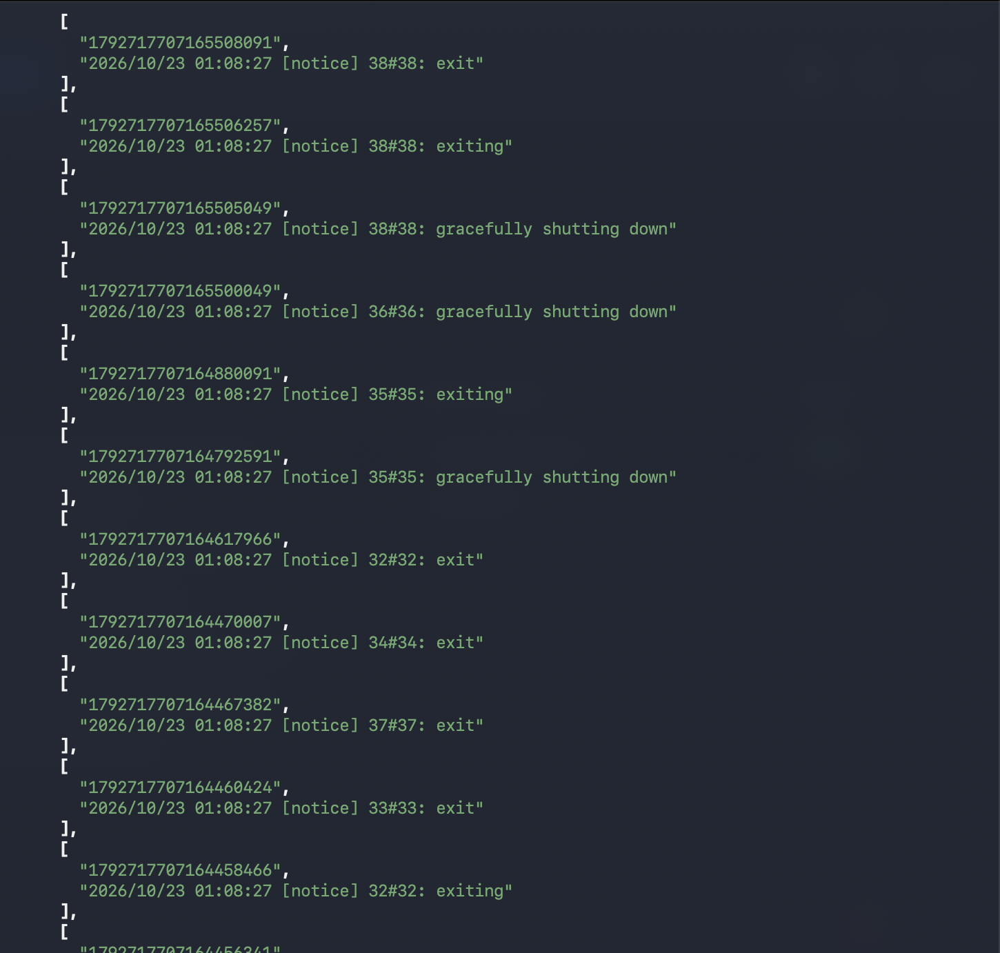

---

## 7. Traefik Logs in Loki

Promtail was also configured to collect logs from the `traefik` namespace.

The logs were successfully received by Loki.

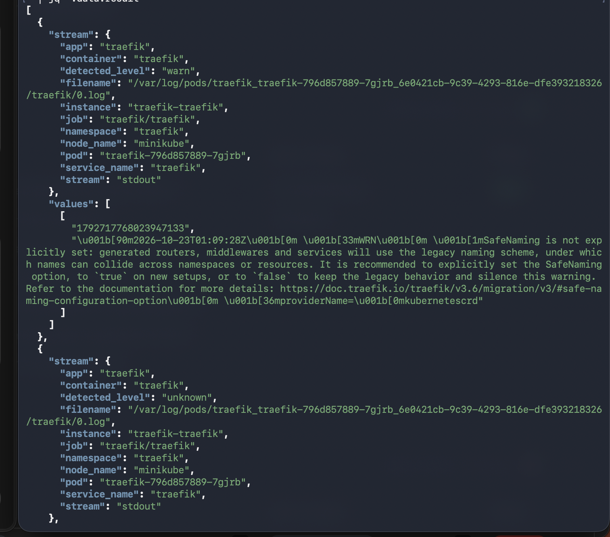

---

## 8. Grafana Installation

Grafana was installed using Helm.

```bash
helm install grafana grafana/grafana \
  --namespace monitoring-mdma \
  -f monitoring/grafana/values.yaml
```

Grafana is running correctly inside the monitoring namespace.

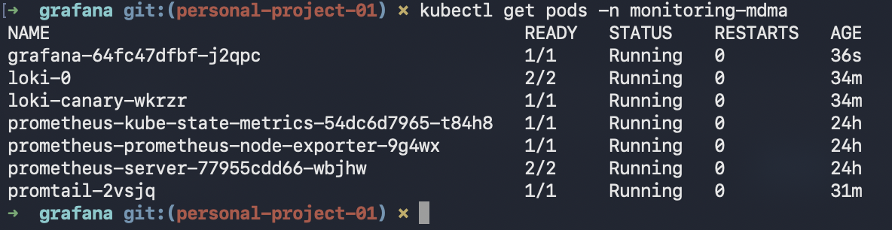

---

## 9. Grafana Data Sources

Prometheus and Loki were configured as Grafana data sources using provisioning in `values.yaml`.

The configuration was not created manually from the Grafana interface.

Configured data sources:

- Prometheus
- Loki

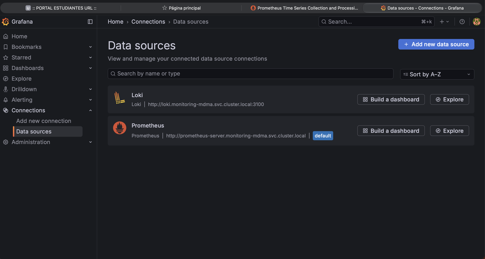

---

## 10. Kubernetes Metrics Dashboard

A Grafana dashboard was created as code to display Kubernetes cluster metrics.

The dashboard includes:

- CPU usage by pod
- Memory usage by pod
- Pod status

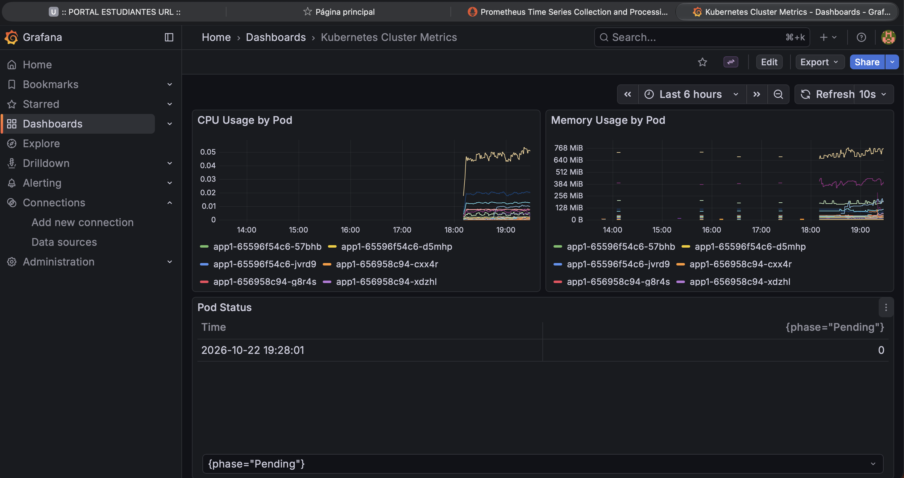

---

## 11. Application Logs Dashboard

A second Grafana dashboard was created using Loki as the data source.

The dashboard contains log panels for:

- app1
- app2
- app3
- app4

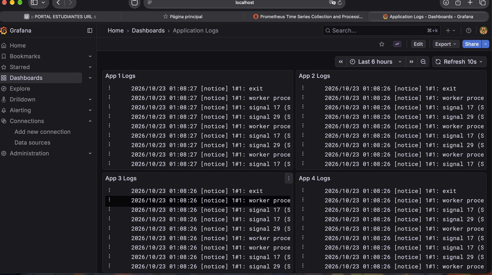

---

## 12. Traefik Ingress

Grafana and Prometheus were exposed using Traefik.

The configured domains are:

```text
grafana.mdma.local
prometheus.mdma.local
```

The Ingress resources route traffic to the corresponding Kubernetes services.

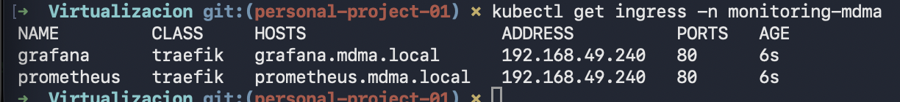

---

## 13. Local DNS Configuration

The following entries were added to `/etc/hosts`:

```text
127.0.0.1 grafana.mdma.local
127.0.0.1 prometheus.mdma.local
```

On macOS, a local port-forward to Traefik was used to access the cluster through the configured domains.

```bash
sudo kubectl port-forward -n traefik svc/traefik 80:80
```

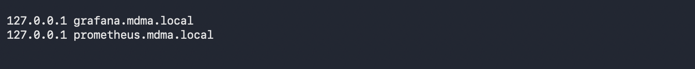

---

## 14. Grafana Domain Access

Grafana can be accessed using:

```text
http://grafana.mdma.local
```

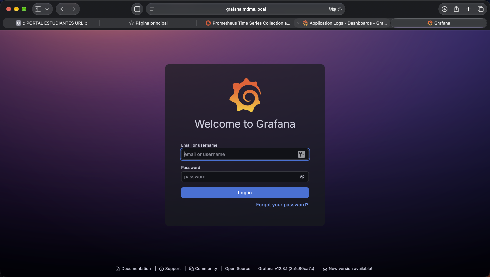

---

## 15. Prometheus Domain Access

Prometheus can be accessed using:

```text
http://prometheus.mdma.local
```

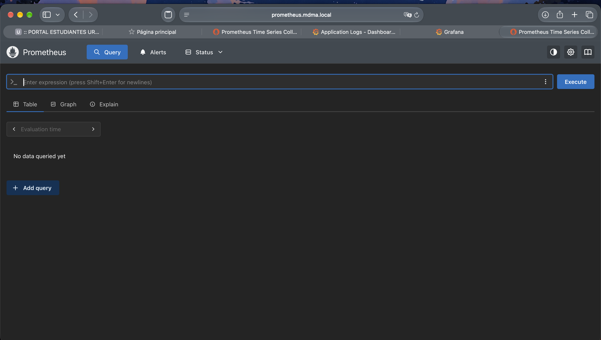

---

## 16. Complete Monitoring Stack

The complete monitoring stack runs inside the `monitoring-mdma` namespace.

```bash
kubectl get pods -n monitoring-mdma
```

The namespace contains:

- Grafana
- Loki
- Loki Canary
- Prometheus Server
- kube-state-metrics
- node-exporter
- Promtail

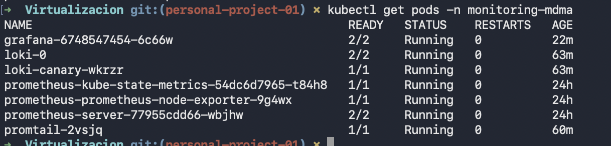

---

## Project Structure

```text
monitoring/
├── prometheus/
│   └── values.yaml
├── loki/
│   └── values.yaml
├── promtail/
│   └── values.yaml
├── grafana/
│   ├── values.yaml
│   ├── cluster-metrics-configmap.yaml
│   ├── application-logs-configmap.yaml
│   └── dashboards/
│       ├── cluster-metrics.json
│       └── application-logs.json
└── ingress/
    ├── grafana-ingress.yaml
    └── prometheus-ingress.yaml
```

## Final Result

The monitoring stack was successfully implemented in Minikube.

Prometheus collects Kubernetes metrics, Promtail collects container logs, Loki stores the logs, and Grafana displays both metrics and logs through provisioned data sources and dashboards.

Grafana and Prometheus are exposed through Traefik using local domain names.