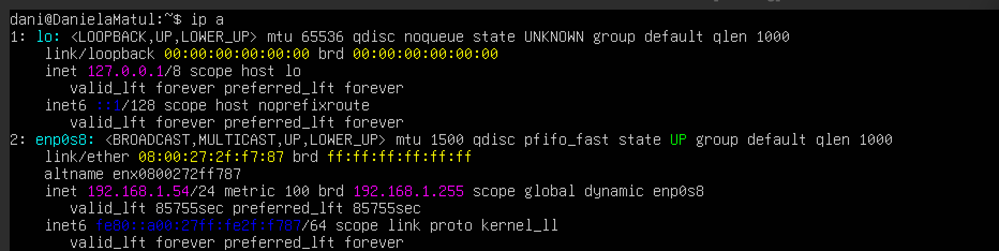
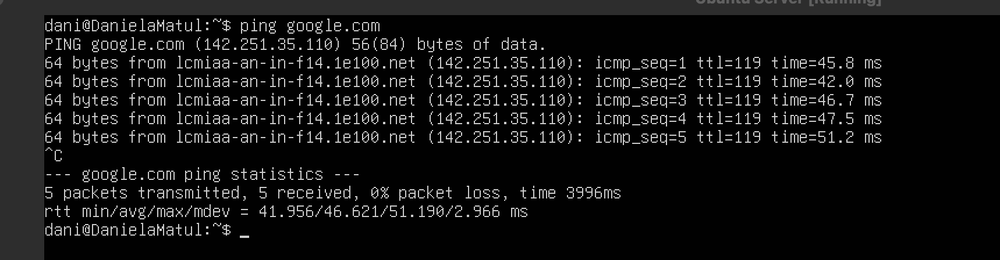
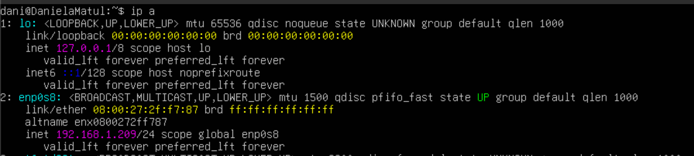
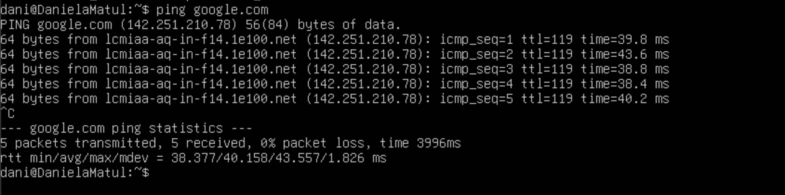
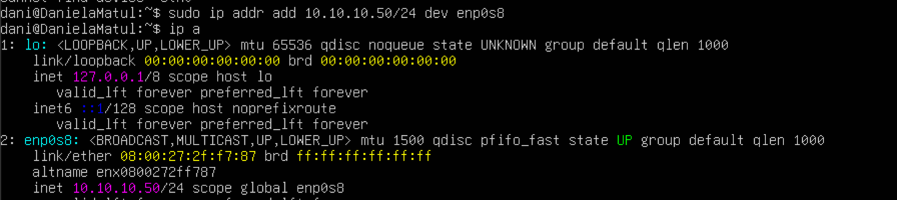
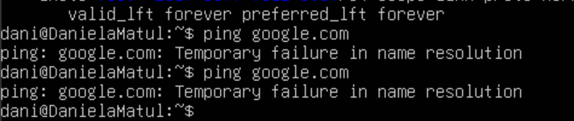
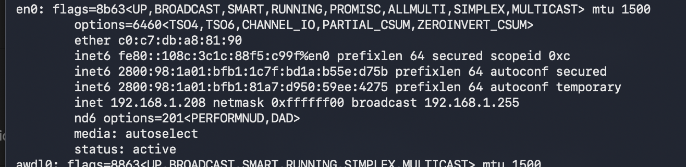

# HW-03
In this homework, we will see how our vm interacts with different IP confiigurations using Bridge mode

VM: Ubuntu Server

## Hostname

---

## Scenario 1
Bridge + DHCP

1. Ip 

2. ping to google.com

---

## Scenario 2
Bridge + Manual IP, same subnet

1. IP

The virtual machine was configured with the IP address 10.10.10.10, which is outside the host network. Because of this, the VM cannot communicate with the router or access the Internet, so the ping to Google fails.
2. ping to google.com

---

## Scenario 3
Bridge + IP manual fuera de la subred
1. IP

2. ping to google.com

---

## Hipervisor

