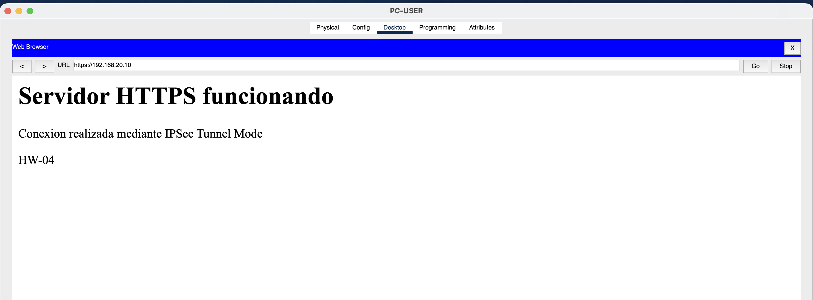

# HW-04 - IPSec Site-to-Site

## Description

In this activity, two different networks were connected using an IPSec site-to-site VPN in tunnel mode. A third router was used to simulate the Internet between both networks.

## Network Topology

- Network A: `192.168.10.0/24`
- Network B: `192.168.20.0/24`
- R1 - Internet: `10.0.0.0/30`
- Internet - R2: `20.0.0.0/30`

The IPSec tunnel was configured between R1-SEDE-A and R2-SEDE-B.

## HTTPS Test

From PC-USER, the HTTPS server was accessed using:

`https://192.168.20.10`

The web server successfully responded to the request from the opposite network.

## Packet Tracer File

The Packet Tracer configuration file is included in this branch:

`hw-04-ipsec.pkt`hw-04-ipsechw-04-ipsec