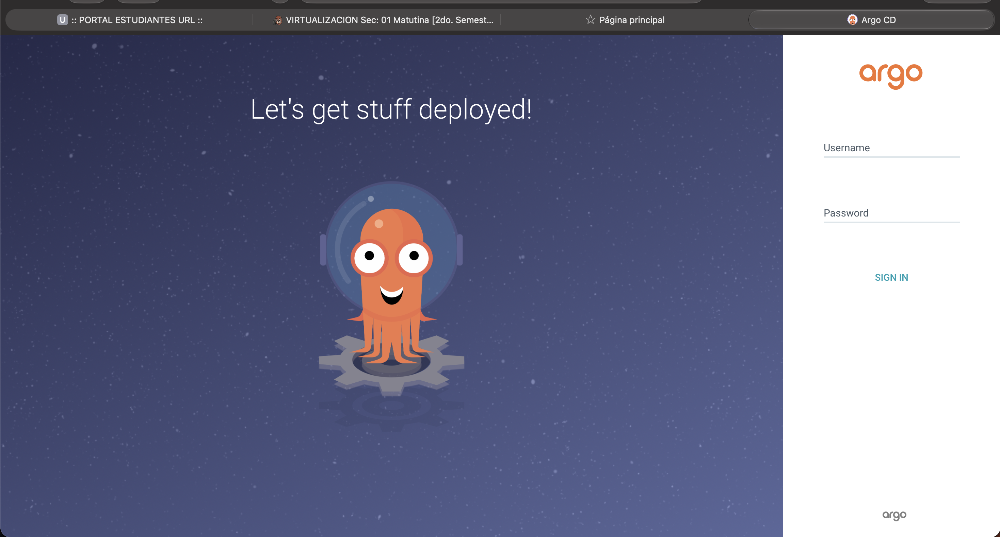
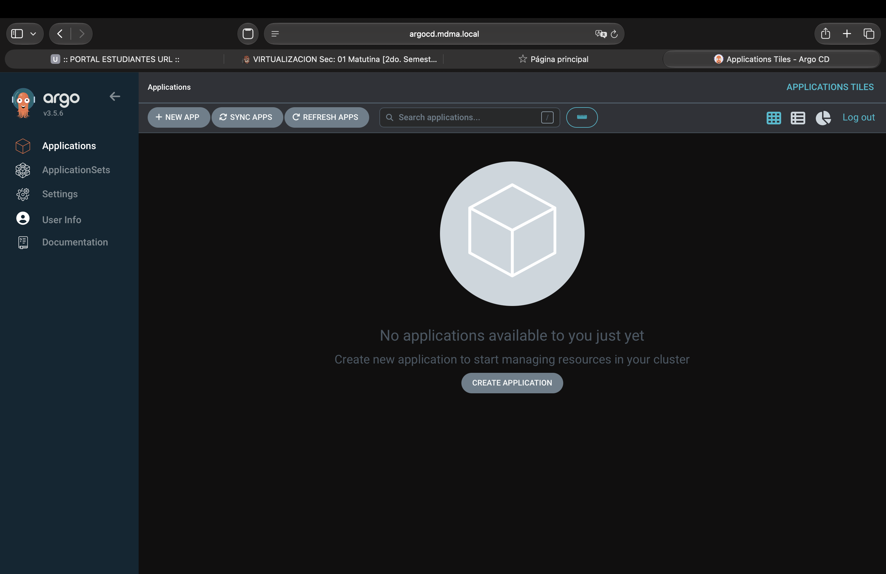
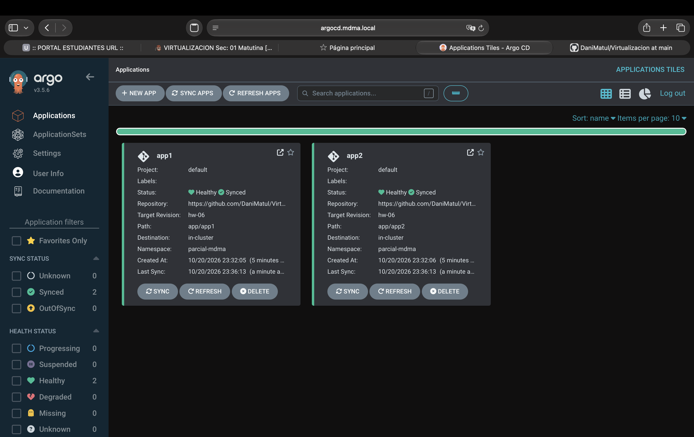
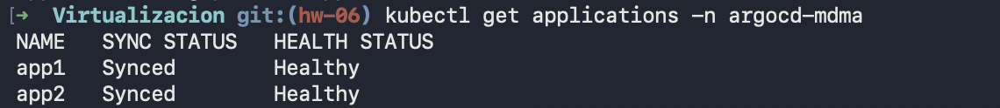
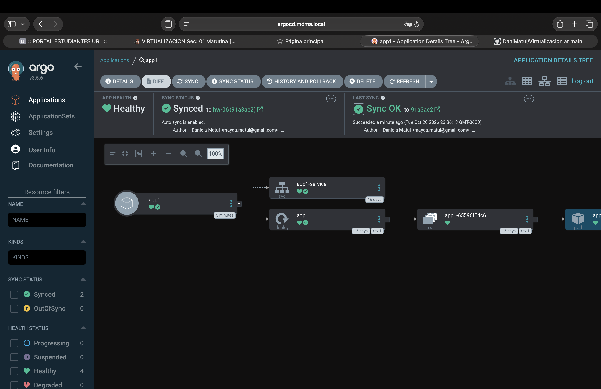
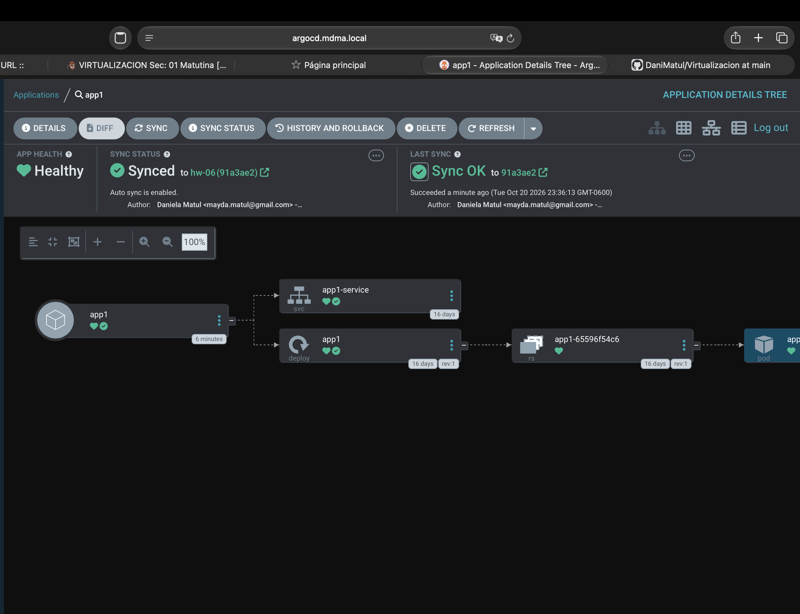
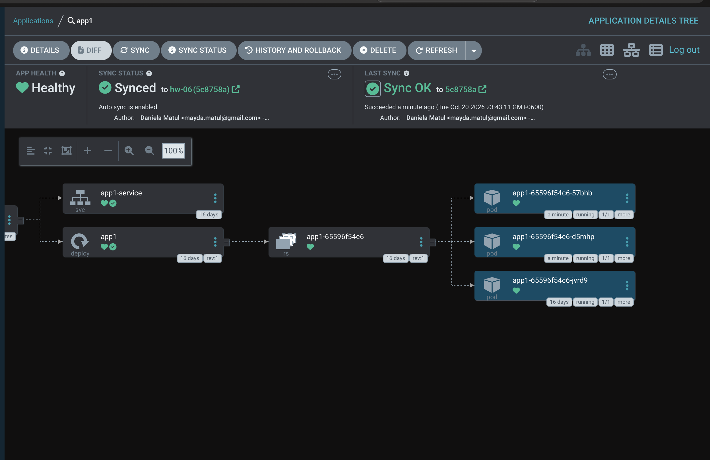

# Assessment 06 - Argo CD and GitOps

## Argo CD Access

Argo CD was accessed using the local domain:

`http://argocd.mdma.local`

---

## Applications

At first, there were no applications created in Argo CD.

After creating `app1` and `app2`, both applications appeared as `Healthy` and `Synced`.

The same status was verified from the terminal.

---

## App1 Before the Change

The `app1` application was synchronized correctly.

The application status was `Healthy` and `Synced`.

---

## GitOps Synchronization Test

The number of replicas in `app1` was changed from `1` to `3`.

The change was committed and pushed to GitHub.

Argo CD detected the change and synchronized the cluster automatically.

---

## Conclusion

Argo CD was installed and configured successfully.

Two applications were deployed using GitOps, and the change in `app1` was synchronized automatically.